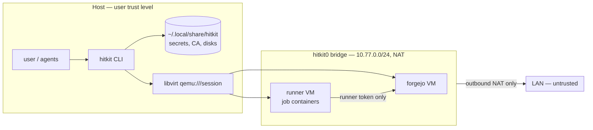
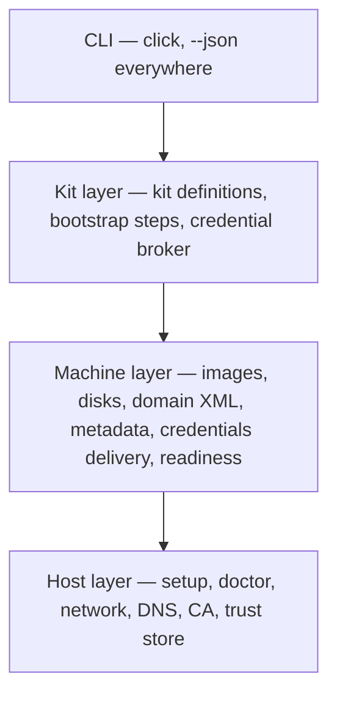

# hitkit — Design Document

| | |
|---|---|
| **Status** | Draft — awaiting approval |
| **Scope** | MVP plus the roadmap shape needed to keep MVP decisions forward-compatible |
| **Distribution** | Source only (git checkout); not published to any package index at this time |
| **Last updated** | 2026-10-12 |

---

## 1. Summary

**hitkit** (*home infrastructure toolkit*) is an opinionated CLI that provisions
self-hosted development infrastructure — a code forge, CI runners, dependency
automation, and later hypervisors, caches, and agent sandboxes — as libvirt VMs
on the user's own Linux workstation.

The user runs one command; hitkit builds the images, boots the VMs, generates
and brokers every credential between services, and hands back URLs and scoped
tokens. The configurations are curated by the project, not authored by the
user. That curation — choosing the services, wiring them together, and owning
the threat model — is the product.

```console
$ sudo hitkit setup          # once: network, DNS, bridge permission
$ hitkit up forge            # Forgejo + CI runner + Renovate, wired together
$ hitkit creds forge         # URLs, logins, tokens
$ hitkit token create forge --name my-agent --scope repo
```

## 2. Goals and non-goals

### Goals

1. **One command per environment.** `hitkit up <kit>` produces a working,
   wired-together environment with no further configuration.
2. **No credential handling by the user.** hitkit generates, stores, delivers,
   and scopes every secret. The user (or their agent) asks hitkit for what they
   need.
3. **A documented, pre-made threat model.** hitkit takes a deliberate stance;
   users inherit an explicit list of controls and accepted risks instead of
   performing their own analysis.
4. **Agent-first.** Every command is non-interactive by default, offers
   `--json` output, and has stable exit codes. An agent can drive hitkit as
   easily as a human.
5. **Local and self-reliant.** No external services beyond package/image
   sources and whatever model provider the user already uses.
6. **Minimal code to steward.** Prefer platform features (libvirt, systemd,
   Forgejo built-ins) over code we write. Borrowed ideas must earn their
   maintenance cost.

### Non-goals

- **Not an IaC tool.** No user-authored topologies, no general resource
  graph, no third-party kit plugin system (see §3, *the knob rule*).
- **No migration/export feature.** Users move a setup they like to permanent
  infrastructure by whatever means they prefer (e.g. IaC committed to the local
  forge and pushed elsewhere).
- **No macOS or Windows hosts.** Linux desktops/laptops only.
- **No container backend on the host.** Containers exist *inside* guests
  (e.g. CI job containers), never as a hitkit provisioning target.
- **No hypervisor other than libvirt + QEMU/KVM** for the foreseeable future.
- **No GitHub-runner-image fidelity.** Runners aim for "most Actions work",
  not byte-for-byte `ubuntu-latest`.

## 3. Design principles

1. **The knob rule.** *Knobs may change sizing and toggle features; they may
   never change topology.* `--memory 8G`, `--runners 2`, and `--no-renovate`
   are allowed. "Put the database on its own VM" is not. Counts of identical
   machines are sizing; new kinds of machines or connections are topology.
2. **libvirt is the source of truth.** What exists is whatever libvirt says
   exists, annotated by hitkit metadata in the domain XML. hitkit keeps no
   database. Files on disk (secrets, disks) are subordinate to libvirt and are
   garbage-collected when no domain claims them.
3. **Root once.** `sudo hitkit setup` is the only privileged operation. Every
   other command runs as the invoking user, so an agent running hitkit gains
   nothing beyond that user's own privileges.
4. **Controls live inside the abstraction.** Security properties (single-use
   tokens, name-constrained CA, secrets never in argv) are enforced by hitkit
   itself, not left to user configuration.
5. **Platform over code.** Use systemd credentials, libvirt networks, dnsmasq,
   Forgejo's built-in registry/mirrors/OAuth, etc. before writing our own.

## 4. Target environment

| | |
|---|---|
| **Supported hosts** | Arch Linux / CachyOS (tier-1), Debian 13, Fedora 44 (each verified by running hitkit nested in a VM of that distro; see §13.9) |
| **Host requirements** | x86-64 with KVM; libvirt ≥ 10; QEMU with `qemu-bridge-helper`; OVMF; mkosi 25 or ≥ 27 (not 26); Python ≥ 3.12. `hitkit doctor` prints the exact package list for the host's distribution. |
| **Guest OS** | Debian 13 (trixie), systemd-based |
| **Forgejo** | ≥ 15.0 (ephemeral runners, job-queue API) |
| **forgejo-runner** | > 12.5 (`one-job`, ephemeral registration) |

Other distros are a post-MVP goal, dogfooded from a working tier-1 install.

## 5. Threat model

### Assumptions

- The host is a single-user interactive workstation.
- Anything running as that user — including AI agents the user launches — is
  trusted at the user's level. hitkit does not try to protect the user from
  their own processes.
- The LAN is untrusted.
- Guests are semi-trusted. The forge holds the user's code; the CI runner
  executes code *and its dependencies*, so the runner is treated as the most
  exposed component.

### Trust boundaries



### Controls

| Threat | Control |
|---|---|
| Agent or tool driving hitkit escalates to root | VMs run in `qemu:///session`; only `setup` needs sudo. Driving hitkit is equivalent to being the user. |
| Services exposed to the LAN | Services bind only on the `hitkit0` bridge. libvirt NAT rules admit only established/related inbound traffic. No host port forwards by default. |
| Secrets leaked via process listings or logs | Secrets are never passed in argv or host env. Delivery to guests goes through fw_cfg files referenced (not inlined) in domain XML. |
| Secrets at rest on the host | Plain `0600` files in a `0700` directory. **Accepted:** anything able to read them already runs as the user. |
| Secrets at rest in guests | Delivered as systemd credentials (kept on a non-swappable tmpfs by systemd), not written into images or cloud-init seeds. |
| Stolen CA key used to MITM the host | CA certificate carries **Name Constraints** limited to `hitkit.internal` and the hitkit subnet. Adding it to the host trust store is opt-in. |
| CI job steals the runner credential | MVP: the runner VM holds only its own runner token, never an admin token; jobs run in containers. Roadmap: ephemeral single-use registrations per job (§11). |
| Job-to-job contamination on the runner | Persistent runners: accepted. `runs-on: ephemeral` (or `--runners 0 --ephemeral N`, which routes every job there) gets a fresh VM per job with a single-use registration, so nothing carries over between jobs (§13.1). |
| Guest image supply chain | Images are built locally by mkosi from the Debian archive (signed). Third-party binaries and images are pinned by version and checksum/digest (§8.1). Versions are recorded in every image and domain. |
| hitkit deleting resources it does not own | Ownership is decided by hitkit metadata in libvirt, never by name (§7.4). |
| SSH MITM on first connection | A per-VM SSH host key is generated on the host, delivered as a credential, and pinned in a per-VM `known_hosts`. No trust-on-first-use. |

### Explicitly accepted risks

- **QEMU escape lands in the user's account.** Session mode trades sVirt
  confinement of QEMU for no root-equivalent libvirt access. An escape requires
  a hypervisor exploit; the alternative (libvirt group membership) is
  root-equivalent by design.
- Host-side secrets are not encrypted at rest.
- Persistent runner VMs are long-lived (use the ephemeral pool for untrusted code).
- Forgejo allows migrations and mirrors to private networks (`ALLOW_LOCALNETWORKS`). Guests already have NAT egress to the LAN, so this grants nothing new.
- `hitkit up forge` edits `~/.ssh/config`, inserting a marked `Include` block that `destroy` removes.

## 6. Architecture

hitkit has four layers. Each layer only calls downward.



| Layer | Responsibility | Key platform features used |
|---|---|---|
| **Host** | One-time and diagnostic host configuration | libvirt networks, dnsmasq, `/etc/qemu/bridge.conf`, p11-kit `trust` |
| **Machine** | Turn "machine spec + credentials" into a running, ready VM | mkosi, qcow2 backing files, libvirt `<metadata>`, fw_cfg, systemd credentials |
| **Kit** | Curated environments composed of machines; post-boot wiring | Forgejo REST API |
| **CLI** | Thin argument parsing and output formatting | — |

The CLI stays thin so the core can be reused or reimplemented in a compiled
language later without redesign.

## 7. Host layer

### 7.1 `hitkit setup` (requires sudo, idempotent)

`setup` prints every change it will make, then performs them:

1. Defines and autostarts the `hitkit` network in `qemu:///system`:
   NAT mode, bridge `hitkit0`, subnet `10.77.0.0/24` (overridable with
   `--subnet`), domain `hitkit.internal`, and DNS host records for **every
   address slot** in §7.2.
2. Appends `allow hitkit0` to `/etc/qemu/bridge.conf`.
3. Writes a managed block of `/etc/hosts` with the same slot records, so the
   host resolves `*.hitkit.internal` without depending on systemd-resolved
   configuration.
4. If **ufw** is active, adds four rules commented `hitkit`: DNS (53/udp,
   53/tcp) and DHCP (67/udp) in on `hitkit0`, and `route allow in on hitkit0`.
   ufw's base chains use `policy drop`, and in nftables a drop in any base chain
   wins over libvirt's own accept rules. Without these, guests have no DNS and
   no egress.
5. Optionally, with `--trust`, installs the hitkit CA into the host trust
   store (equivalent to `hitkit trust install`).

When the network definition is outdated (e.g. a newer hitkit adds address
slots), setup replaces it in place, keeping its UUID. Running VMs must be
restarted to reattach. A network hitkit did not create, or a subnet change, is
refused without `--force`.

`hitkit setup --remove` reverses all of the above.

Because topology is fixed (principle 1), the full address plan is known at
setup time. hitkit never needs root again to register a new VM.

### 7.2 Address plan

| Address | Name | Purpose |
|---|---|---|
| `.1` | `host.hitkit.internal` | Host side of `hitkit0`; dnsmasq |
| `.2`–`.9` | — | Reserved |
| `.10` | `forgejo.hitkit.internal` | Forge |
| `.20`–`.29` | `runner-N.hitkit.internal` | Persistent runners |
| `.30` | `proxmox.hitkit.internal` | Roadmap |
| `.40` | `devbox.hitkit.internal` | `devbox` kit: plain Debian VM |
| `.50` | `dev.hitkit.internal` | `hitkit-dev` kit: Arch VM for developing hitkit (nested) |
| `.100`–`.199` | `ci-N.hitkit.internal` | Roadmap: ephemeral runner pool |
| `.200`–`.250` | — | DHCP range for ad-hoc, non-hitkit VMs |

Guests receive static addresses. DNS names are a convenience layered on top.

### 7.3 Certificate authority

- Generated on first need. Stored at `~/.local/share/hitkit/ca/` (`ca.key`
  `0600`, `ca.crt`).
- Implemented with the `cryptography` library. No CA service, no ACME:
  hitkit creates every machine, so it signs each machine's leaf certificate at
  `up` time and delivers it as a credential.
- The root carries **Name Constraints** permitting only `hitkit.internal` and
  the hitkit subnet.
- `hitkit trust install|remove` (sudo) manages the host trust store via
  `trust anchor` (p11-kit). On Arch this also covers Firefox/NSS.

### 7.4 `hitkit doctor`

Read-only. Checks and reports, with a remediation hint for each failure:

- KVM present; nested virtualization (needed later for Proxmox).
- libvirt reachable at `qemu:///session` and the `hitkit` network active.
- `qemu-bridge-helper` setuid and `hitkit0` allowed in `bridge.conf`.
- firewalld/ufw presence. ufw rules are root-only to read, so the guest's
  `dns` readiness gate is what verifies them in practice.
- No route collision between the hitkit subnet and existing routes or VPNs.
- `edk2-ovmf`, mkosi, `apt`, and `debian-archive-keyring` present.
- Host trust store state (if `trust install` was used).
- Orphans: VM directories or images that no libvirt domain claims.

`doctor` also *reports* host CPU, RAM, and free disk alongside the published
kit minimums (§9.6) for information. Neither `doctor` nor `up` ever refuses to
run because of them.

## 8. Machine layer

### 8.1 Images

- Built locally with **mkosi**. `images/<role>/` is a complete mkosi
  configuration per role, with its own distribution. `base` is Debian 13 and
  `hitkit-dev` is Arch. Every role pulls in `images/common/` via `ExtraTrees=`
  and `RepartDirectories=`: the provision and readiness units and scripts, the
  sshd drop-in, the data-disk fstab entry, the partition layout, and a systemd
  **preset** file.
- Units are enabled through presets, not `systemctl enable` in postinst.
  mkosi applies presets after postinst, and Arch's default policy is
  `disable *`.
- Every image masks `systemd-firstboot` (it otherwise blocks boot on an
  interactive console prompt) and the distro's SSH host-key generator, so each
  machine has exactly one pinned ed25519 host key.
- The root partition is a fixed 10 GiB. The raw image is sparse, so the
  qcow2 stays small (~0.5 GiB for `base`). Persistent data lives on the data
  disk, which systemd formats on first boot (`x-systemd.makefs`) and mounts at
  `/srv/data`.
- Role-specific provisioning goes in `/usr/lib/hitkit/provision.d/` and
  role-specific readiness gates in `/usr/lib/hitkit/ready.d/`.
- Images include the QEMU guest agent. It is not used for control in MVP;
  it is kept for diagnostics.
- Output is converted to qcow2 and cached at
  `~/.cache/hitkit/images/<role>-<hash>.qcow2`, where `<hash>` covers the mkosi
  configuration and the pinned third-party versions. A changed hash means a
  rebuild; existing VMs are unaffected.
- Images boot via UEFI (OVMF). Each VM gets its own NVRAM copy.

#### Version policy

Third-party versions are **pinned**. The initial release pins the latest
stable version of every component as of implementation time. After that,
versions move only through deliberate, reviewed bumps to the pins.

| Component | Source | Pinned as |
|---|---|---|
| Debian base | `trixie`, `trixie-updates`, `trixie-security` | Release (`trixie`); packages come from the stable archive at build time, verified by Debian's archive signatures |
| Forgejo | Upstream release binary | Version + SHA-256 in `kit.toml` |
| forgejo-runner | Upstream release binary | Version + SHA-256 in `kit.toml` |
| Docker Engine | Docker's official apt repository (`docker-ce`), not Debian's older `docker.io` | Version in the mkosi profile; repository key pinned |
| Renovate | Container image used by the scheduled workflow | Image tag + digest |
| Job images (`ubuntu-latest`, …) | Container registry | Image tag + digest in the runner config |

- **Versions are recorded** in an image manifest beside the qcow2 and copied
  into domain metadata (§8.4). `hitkit status` therefore shows exactly what each
  VM runs.
- **Upgrading is explicit.** Moving a running VM onto a newer image is
  `hitkit upgrade` (roadmap). `up` never silently replaces a running VM.

### 8.2 Disks and per-VM directory

Each VM owns exactly one directory. The directory existing *is* the record of
intent; nothing is created outside it.

```
~/.local/share/hitkit/vms/<vm>/
├── os.qcow2          # overlay, backing file = cached image (disposable)
├── data.qcow2        # persistent service data (e.g. /var/lib/forgejo)
├── nvram.fd
├── creds/            # 0700; one file per credential, referenced by fw_cfg
├── known_hosts       # pinned SSH host key
└── console.log       # serial console
```

Splitting OS and data disks means a future `hitkit upgrade` can replace the OS
overlay with one on a newer image without touching repositories or database.

### 8.3 Domains

- Defined in `qemu:///session`, named `hitkit-<vm>`.
- q35 machine, `host-passthrough` CPU, virtio disk and network, UEFI.
- Network interface: `<interface type='bridge'>` on `hitkit0`, attached
  through `qemu-bridge-helper`. MAC addresses derive deterministically from
  the address slot.
- The serial console is logged to `console.log`.

### 8.4 Metadata and ownership

Every domain carries a hitkit metadata element:

```xml
<metadata>
  <hitkit:machine xmlns:hitkit="urn:hitkit:metadata:1">
    <install-id>…</install-id>       <!-- random per host install -->
    <kit>forge</kit>
    <role>forgejo</role>
    <kit-version>1</kit-version>
    <image>forgejo-3fa9…</image>
    <versions>
      <component name="forgejo">15.x.y</component>
      <component name="debian">13.x</component>
    </versions>
    <address>10.77.0.10</address>
    <created>2026-10-12T00:00:00Z</created>
  </hitkit:machine>
</metadata>
```

Every domain is classified as one of:

| Class | Rule | hitkit may modify? |
|---|---|---|
| **owned** | Metadata present and `install-id` matches | Yes |
| **foreign** | No hitkit metadata | Never |
| **indeterminate** | Metadata malformed or from another install | Only with `--force` |

`hitkit gc` deletes VM directories and cached images that no owned domain
references. Image references are checked with `qemu-img info --backing-chain`.

### 8.5 Credential delivery

- Each credential is a file in `vms/<vm>/creds/`, exposed to the guest via
  libvirt `<sysinfo type='fwcfg'>` entries named
  `opt/io.systemd.credentials/<name>` with `file=`. The domain XML references
  the files and never contains secret values.
- systemd in the guest imports these into the system credential store at
  boot. Units consume them with `ImportCredential=` or `LoadCredential=`.
- The naming is systemd's, but the transport is init-agnostic. A
  non-systemd guest could read `/sys/firmware/qemu_fw_cfg/by_name/…` directly.
  Nothing in MVP needs this.

Credentials delivered to every machine:

| Credential | Consumer |
|---|---|
| `hitkit.network` | First-boot unit writes the static systemd-networkd config |
| `hitkit.ssh-host-key` | First-boot unit installs the pinned host key |
| `ssh.authorized_keys.root` | systemd's built-in provisioning |
| `hitkit.tls.crt` / `hitkit.tls.key` / `hitkit.ca.crt` | Service TLS and guest trust store |

Plus the role-specific credentials listed for each kit (§9).

### 8.6 Readiness

A `hitkit-ready.service` unit in the guest runs role-specific gate checks
after boot. It writes either `HITKIT-READY` or `HITKIT-FAILED gate=<name>
detail=<text>` to the serial console. `hitkit up` tails `console.log`, so a
broken boot is reported by gate name within seconds instead of after a
timeout. After the guest reports ready, hitkit also checks the service
health endpoint over the bridge.

## 9. Kits

### 9.1 Definition

A kit is an in-tree directory: `src/hitkit/kits/<kit>/kit.toml` (machines, default
sizes, knobs) and an optional `hooks.py` (host-side wiring). Its machines name image
roles in `src/hitkit/images/<role>/` (mkosi configuration, pinned artifacts) and
address slots in `addressing.py`. `docs/kits.md` is the authoring guide.

Kits are curated and shipped with hitkit. There is no external kit loading.

### 9.2 Kits available today

| Kit | Machines | Purpose |
|---|---|---|
| `devbox` | `devbox` (.40): Debian 13, 2 vCPU, 2 GiB, 20 GiB data | Plain VM with SSH; the base every kit builds on |
| `hitkit-dev` | `dev` (.50): Arch Linux, 4 vCPU, 8 GiB, 80 GiB data | Dogfooding: develop and test hitkit inside hitkit. It ships the full host toolchain (libvirt, QEMU, mkosi, Debian bootstrap tools, Python/uv), a passwordless-sudo `dev` user whose home is on the data disk, and a nested hitkit config on `10.78.0.0/24` so the nested network cannot collide with the VM's own uplink. Requires nested virtualization; its `kvm` readiness gate checks for it. |
| `hitkit-dev-debian`, `hitkit-dev-fedora` | `dev-debian` (.51), `dev-fedora` (.52) | The same, on Debian 13 and Fedora 44: how hitkit's Debian/Fedora host support is tested (§13.9) |
| `forge` | `forgejo` (.10), `runner-N` (.20–.29), `ci-N` job VMs (.100–.199) | Forgejo, CI runners, the ephemeral pool, Renovate (§9.3, §13.1) |
| `cache` | `cache` (.60): 2 vCPU, 2 GiB, 100 GiB data | Pull-through caches (§13.3) |
| `proxmox` | `proxmox` (.30): 4 vCPU, 8 GiB, 100 GiB data | Proxmox VE 9 with API token (§13.4) |
| `ludus` | `ludus` (.31): 8 vCPU, 32 GiB, 250 GiB data | Ludus 2.3.8 cyber ranges on Proxmox VE 9 (§13.14) |

### 9.3 MVP kit: `forge`

| Machine | Slot | Default size | Contents |
|---|---|---|---|
| `forgejo` | `.10` | 2 vCPU, 2 GiB, 20 GiB OS + 20 GiB data | Forgejo ≥ 15 with SQLite, HTTPS via hitkit CA leaf |
| `runner-1` | `.20` | 4 vCPU, 8 GiB, 60 GiB OS | forgejo-runner `daemon` + Docker |

**Knobs:** `--runners N` (1–10), per-machine `--cpus` and `--memory`, and
`--no-renovate`.

**Bring-up sequence:**

1. hitkit generates the Forgejo secrets (`SECRET_KEY`, `INTERNAL_TOKEN`, JWT
   secrets), a `hitkit-admin` password, the human user's password, a 40-hex
   shared secret per runner, and TLS material. All are stored under
   `secrets/forge/`. They are delivered as `hitkit.fj.*` and `hitkit.runner.*`
   credentials; names stay within 28 characters because QEMU caps fw_cfg names
   at 55.
2. The `forgejo` VM boots. A provision hook renders `app.ini` from credentials
   (`INSTALL_LOCK=true`, HTTPS on 443, SQLite on the data disk). A
   `forgejo-bootstrap` unit then migrates the database and ensures the
   `hitkit-admin` account matches its credential. The readiness gate is
   `GET /api/healthz` over HTTPS with certificate verification.
3. Once Forgejo is ready, hitkit:
   - registers each runner over SSH with
     `forgejo-cli actions register --name runner-N --secret-stdin -`. The
     secret goes over stdin, never argv. Registration is idempotent.
   - mints its own admin API token with basic auth (stored host-side only);
   - creates the human user (default: `$USER`).
4. Each `runner-N` boots holding only its runner token, the CA certificate, and
   network credentials. The runner's UUID is the first 16 characters of the
   secret formatted as a UUID, the same derivation `forgejo-cli` uses, so
   hitkit computes it host-side. `forgejo-runner` reads its token directly
   from its systemd credential via
   `server.connections.<name>.token_url: file:$CREDENTIALS_DIRECTORY/...`.
   There is no `.runner` file and no deprecated `create-runner-file`.
5. If Renovate is enabled (default), hitkit creates a `renovate-bot` user and
   token, a `hitkit` org (the human user is an owner), an org secret holding
   the token, and a `hitkit/renovate` repository with an hourly and
   dispatchable workflow. The workflow runs the pinned Renovate container with
   `platform: forgejo`, autodiscovery, no onboarding PR, and optional config.
   To opt a repository in, add `renovate-bot` as a collaborator with write
   access.

### 9.4 Runner labels and CA propagation

The runner maps `runs-on` labels to container images, e.g.
`ubuntu-latest:docker://<image>`. Jobs run in throwaway containers on the
long-lived runner VM.

**Why job containers need the CA.** Forgejo's `ROOT_URL` is
`https://forgejo.hitkit.internal`, and Forgejo hands that URL to every job
(`GITHUB_SERVER_URL`, artifact and cache endpoints). Without the CA, the first
`actions/checkout` fails certificate verification. Making jobs use plain HTTP
would mean either an HTTP `ROOT_URL` (TLS lost for humans too) or a second
internal endpoint Forgejo cannot advertise, so the CA has to reach jobs.

**Scoped, additive trust.** We never replace a container's trust bundle. Only
the clients that talk to Forgejo learn about the hitkit CA:

| Client | Mechanism | Covers |
|---|---|---|
| Node | `NODE_EXTRA_CA_CERTS=/etc/hitkit/ca.crt` (additive to Node's bundle) | Node-based actions: cache, artifacts, Renovate's API calls |
| git | `GIT_CONFIG_COUNT=1`, `GIT_CONFIG_KEY_0=http.https://forgejo.hitkit.internal/.sslCAInfo`, `GIT_CONFIG_VALUE_0=/etc/hitkit/ca.crt` | `actions/checkout`, Renovate's git operations. Applies **only** to URLs on the forge; github.com etc. use the image's normal bundle. |
| Docker daemon (runner VM, not a job container) | `/etc/docker/certs.d/forgejo.hitkit.internal/ca.crt`, baked at first boot | `container:` and `services:` images pulled from Forgejo's registry |
| Runner VM itself | System trust store, from the `hitkit.ca.crt` credential | `forgejo-runner` ↔ Forgejo |

The runner config sets these variables for every job and mounts the CA
read-only at `/etc/hitkit/ca.crt`.

**Tools that scrub their environment.** Renovate runs git with a curated
environment, so `GIT_CONFIG_*` never reaches it. The managed Renovate workflow
therefore writes the same per-URL `sslCAInfo` (forge URL only) into the job
container's global git config before running Renovate. Verified end to end:
Renovate's API calls work via `NODE_EXTRA_CA_CERTS`, and its git operations
work via the global config.

Other clients inside jobs (curl, pip/twine, cargo publishing to Forgejo
package registries) are **not** configured automatically. The documented
answer is "point the tool at `/etc/hitkit/ca.crt`". The CA's name constraints
(§7.3) mean exposing it to job containers grants nothing beyond
`*.hitkit.internal`.

### 9.5 Credentials surfaced to users

`hitkit creds forge` prints URLs and the human user's login.
`hitkit token create forge --name <n> --scope <scopes>` mints a scoped
Forgejo access token for a person or an agent. Tokens are recorded so that
`token list` and `token revoke` work. The `hitkit-admin` token is never
printed.

### 9.6 Published host minimums

Informational only. Published so users can judge fit; never enforced
(§7.4). Figures are estimates to be validated at the end of phase 4. Disks are
thin-provisioned qcow2, so actual usage starts well below the maximum.

| Kit | Machines (vCPU / RAM / max disk) | Host minimum | Recommended |
|---|---|---|---|
| `forge` (1 runner) | forgejo 2 / 2 GiB / 40 GiB; runner-1 4 / 8 GiB / 60 GiB | 4 cores, 16 GiB RAM, 120 GiB free disk | 8 cores, 32 GiB RAM |
| each extra runner | +4 / +8 GiB / +60 GiB | — | — |

The image cache adds about 5 GiB per kit.

## 10. CLI surface

Conventions:

- Every command accepts `--json` (anywhere on the command line).
- No command prompts; destructive commands require `--yes`.
- Exit codes are stable and documented.
- `--debug` (or `HITKIT_DEBUG=1`) mirrors the trace to stderr; errors print a trace id (§13.11).

| Command | Purpose |
|---|---|
| `hitkit setup [--subnet CIDR] [--trust] [--remove]` | One-time privileged host setup (§7.1) |
| `hitkit doctor` | Read-only host diagnostics (§7.4) |
| `hitkit trust install\|remove` | Host trust store management (sudo) |
| `hitkit kits` | List available kits, their machines, and knobs |
| `hitkit up <kit> [knobs…] [--cpus/--memory/--disk [MACHINE=]N]` | Build images if needed, create or start machines, wire services. Idempotent. Sizing is remembered; data disks grow live, never shrink (§13.13). |
| `hitkit down <kit>` | Shut down a kit's machines and keep everything |
| `hitkit destroy <kit> [--delete-data] --yes` | Remove a kit's machines; data disks and secrets are kept unless `--delete-data` (§13.13) |
| `hitkit backup <kit> [--dest DIR] [--keep N] [--online\|--offline] [--schedule daily\|off]`, `hitkit backup --list` | Back up a kit's data and secrets (§13.13) |
| `hitkit restore <kit> [BACKUP_DIR] --yes` | Restore a backup without deleting current data, then re-wire (§13.13) |
| `hitkit status [<kit>]` | Machines, state, addresses, readiness |
| `hitkit ssh <machine> [-- cmd…]` | SSH using the pinned host key |
| `hitkit logs <machine> [-f]` | Serial console log |
| `hitkit creds <kit>` | URLs and human-facing logins |
| `hitkit token create\|list\|revoke <kit> …` | Scoped service tokens for people and agents |
| `hitkit image build\|ls\|prune` | Explicit image management; `ls` shows the pinned versions in each image |
| `hitkit gc [--yes] [--delete-data]` | Remove orphaned VM directories (keeping their data disks) and unreferenced images; `--delete-data` also deletes kept disks |
| `hitkit upgrade <kit>` | Move machines onto current images, keeping data; rollback on failure (§13.2) |
| `hitkit grant OWNER/REPO ACCOUNT [--permission]` | Give a forge account (e.g. `hitkit-dev`, `renovate-bot`) access to one repository |
| `hitkit mirror add\|list\|sync\|remove` | Push mirrors to GitHub/GitLab/any remote (§13.5) |
| `hitkit pool run\|status` | The ephemeral runner pool's loop (run by `hitkit-pool.service`) and its state (§13.1) |
| `hitkit trace [<id>\|last] [--failed]` | Recorded traces: recent invocations, or every record of one (§13.11) |
| `hitkit skills [--install DIR]` | Agent skills for using hitkit (§13.12) |

## 11. Roadmap

| Phase | Deliverable | Exit criterion |
|---|---|---|
| **0 — Host** ✅ | Project skeleton, `doctor`, `setup`, CA, `trust`, ufw integration | `doctor` is green on a fresh CachyOS install |
| **1 — Machine** ✅ | mkosi images; boot a VM with static IP, credentials, pinned SSH, readiness; `kits`, `up`, `down`, `destroy`, `status`, `ssh`, `logs`, `image`, `gc`; `devbox` and `hitkit-dev` kits | Ready in under 60 s with a warm image (measured: 8–9 s from stopped, ~49 s including an image rebuild) |
| **2 — Forge** ✅ | `forgejo` machine and bootstrap; `creds`; `token` | `git push` over HTTPS to the local forge from the host with no TLS warnings |
| **3 — CI** ✅ | Persistent runner with `docker` label; hitkit CA in every job container (§9.4) | A workflow using `actions/checkout` and `actions/cache` passes over HTTPS with certificate verification enabled |
| **4 — Renovate** ✅ | Renovate bot and scheduled workflow | Renovate opens a PR against a test repo |

All MVP exit criteria are automated in `tests/e2e/test_forge.py`
(`HITKIT_E2E=1 uv run pytest tests/e2e`).
| **MVP complete** | | |
| **Done** | Ephemeral runner pool (§13.1) | 18 s from dispatch to success for a fresh VM per job |
| **Done** | `hitkit upgrade` (§13.2) | Data, credentials and host key kept; automatic rollback |
| **Done** | `proxmox` kit (§13.4) | PVE 9.2 API via token over verified TLS; nested guests run |
| **Done** | Pull-through caches (§13.3) | Used automatically by CI jobs |
| Later | Agent devbox machine | |
| **Done** | Push mirrors (§13.5) and git over SSH (§13.6) | |
| Later | Optional GitHub token for Renovate changelog lookups (would be hitkit's only external credential) | |
| On demand | Mailpit, S3-compatible storage (Garage), observability, OpenBao | |
| Later | Readiness over vsock `sd_notify` instead of serial parsing | |
| **Done** | Debian and Fedora hosts (§13.9) | |
| Later | SELinux-enforcing verification on Fedora with a natively built test image | Today: permissive with zero AVC denials |

## 12. Implementation

- **Language:** Python ≥ 3.12. Prototype speed is the priority; the thin CLI
  over a self-contained core keeps a later rewrite feasible.
- **Dependencies (kept minimal):** `libvirt-python` (the distro
  `python-libvirt` package is supported), `cryptography`, `httpx`, `click`.
  Standard library `tomllib` and `dataclasses` instead of pydantic.
- **Install:** from a git checkout only: `pipx install --system-site-packages .`
  (uses the distro `python-libvirt`), or `uv tool install .` with libvirt
  headers present. Publishing to PyPI or the AUR is out of scope for now.
- **Host paths (XDG):**
  - `~/.config/hitkit/config.toml` — subnet, install ID
  - `~/.local/share/hitkit/` — `ca/`, `secrets/<kit>/`, `vms/<vm>/`
  - `~/.cache/hitkit/images/`
  - `~/.local/state/hitkit/logs/` — traces (§13.11)
- **Layout:**

  ```
  src/hitkit/
  ├── cli.py
  ├── host/       # setup, doctor, network, ca, trust
  ├── machine/    # domain XML, metadata, disks, creds, readiness, images
  ├── kits/       # kit loader + in-tree kits
  ├── secrets.py
  └── forgejo.py  # minimal REST client (only the endpoints we use)
  ```

- **Testing:** unit tests for XML generation, metadata classification, and the
  CA, with no libvirt needed. Integration tests run on a real tier-1 host,
  eventually on a hitkit-provisioned runner (dogfooding).

## 13. Post-MVP features

All of these are covered by `tests/e2e/test_later_phases.py`.

### 13.1 Ephemeral runner pool

`hitkit up forge --ephemeral N` runs at most N concurrent single-use job VMs.
`--runners 0 --ephemeral N` sends every job to the pool.

- **Orchestrator.** `hitkit-pool.service` is a **user** systemd service (no
  root) that runs `hitkit pool run`. A reconcile loop works from libvirt (the
  `ci-N` domains) plus one `pool.json` per VM, so a crash or restart loses
  nothing. It takes a file lock so only one instance runs. Each tick it:
  1. reaps finished or timed-out job VMs and their runner registrations;
  2. sweeps orphaned ephemeral `ci-*` registrations;
  3. reads `GET /admin/actions/runners/jobs?labels=…` and, for each waiting
     job up to the maximum, registers an ephemeral runner
     (`POST /admin/actions/runners {"ephemeral": true}`) and boots `ci-N` with
     credentials for that runner's token, UUID and the job's **handle**.
- **Job VM.** The VM runs `forgejo-runner one-job --handle …`, which takes
  exactly that job attempt, then powers off (`SuccessAction=`/`FailureAction=`).
  Forgejo deletes the registration after the job.
- **Warm template.** Booting a fresh VM per job is only fast because of a
  warm template: a data disk with the job images already pulled
  (`~/.cache/hitkit/templates/runner-data-<hash>.qcow2`, read-only). It is
  built once by a `prepull` boot of the runner image and is the backing file
  of every job VM's data disk. Docker 29 keeps images in **containerd**, so
  containerd's root is on the data disk as well.
- **Persisted knobs.** `up` remembers knob values
  (`secrets/<kit>/knobs.json`). Re-running `hitkit up forge` without flags
  keeps the pool; `--ephemeral 0` drains and disables it.

### 13.2 `hitkit upgrade <kit>`

For each machine on an older image than its role's current one, upgrade:

1. stops the VM;
2. keeps the old OS overlay, NVRAM and credentials as `.prev`;
3. syncs kit credentials (a new image may need new ones);
4. boots a fresh overlay on the new image, keeping the data disk and the
   pinned SSH host key;
5. waits for readiness.

On failure it keeps the boot log as `console.failed.log`, restores the old
overlay, NVRAM and credentials, and boots the old image. `status` marks
machines on older images as `(outdated)`, and `up` prints a hint.

`up` also syncs kit credentials on existing machines. When they change, the VM
restarts, because QEMU reads fw_cfg only at start. Redefinitions keep the
domain UUID.

### 13.3 Pull-through caches (`cache` kit, `cache.hitkit.internal`)

| Port | Cache | Upstream |
|---|---|---|
| 5000 | OCI registry (distribution 3.1.2) | Docker Hub |
| 5001 | OCI registry | ghcr.io |
| 5002 | PyPI (proxpi 1.3.0) | pypi.org |
| 5003 | npm (verdaccio 6.8.0, the newest that runs on Debian's Node 20) | registry.npmjs.org |
| 3142 | apt (apt-cacher-ng; HTTPS sources tunnel through uncached) | any |

Caddy terminates TLS with the machine's hitkit CA leaf. When the `cache`
machine exists, runners and job VMs receive a `hitkit.runner.cache` credential.
Docker then uses the Docker Hub mirror, and jobs get `PIP_INDEX_URL`,
`UV_DEFAULT_INDEX` and `NPM_CONFIG_REGISTRY`. Every job also gets a complete CA
bundle (public roots plus the hitkit CA) at `/etc/hitkit/ca-bundle.crt`, with
`SSL_CERT_FILE`, `PIP_CERT` and `REQUESTS_CA_BUNDLE` pointing at it. This
closes the "other clients" gap from §9.4: curl, pip and requests trust the
forge and caches without losing public trust.

### 13.4 `proxmox` kit (`https://proxmox.hitkit.internal:8006`)

Proxmox VE 9 is installed on Debian 13 the documented "install on Debian" way,
from the pinned no-subscription repository (key pinned). It uses the Proxmox
kernel and ifupdown2 with `vmbr0` over the NIC; systemd-networkd is masked,
because it is socket-activatable and would otherwise claim the NIC first.

hitkit generates the root password, installs the hitkit CA leaf on pveproxy
(plain copies, because pmxcfs rejects `chmod`), adds the data disk as `data`
storage, and mints `root@pam!hitkit` with privilege separation off.
`hitkit creds proxmox` prints the URL, login, token and ready-made API header.
Nested KVM works: Proxmox guests run accelerated.

### 13.5 Push mirrors

`hitkit mirror add OWNER/REPO REMOTE_URL` uses Forgejo's built-in push
mirrors.

- **Token handling.** The token comes from `$HITKIT_MIRROR_TOKEN` or stdin,
  never argv.
- **Username.** Guessed for github.com (`x-access-token`) and GitLab
  (`oauth2`); `--username` otherwise.

Verified against a real GitLab CE 19.4 (self-hosted in a test VM) with a
project access token (`write_repository`) and `--username oauth2`. Both the
manual sync and sync-on-commit (within about 5 s) work. Also verified against
github.com (a private throwaway repository, with the automatically chosen
`x-access-token` username): manual sync, and sync-on-commit within about 10 s.
- **Other commands.** `mirror list`, `mirror sync`, `mirror remove`.

### 13.6 Git over SSH

Forgejo's built-in SSH server listens on port 2222, with a host key hitkit
generates and pins (credential `hitkit.fj.git-host-key`). `up forge`:

- creates a dedicated key for the user (`~/.local/share/hitkit/ssh/forge_ed25519`)
  and registers it with their Forgejo account;
- writes `~/.config/hitkit/ssh_config` (Host, Port, User, IdentityFile and a
  pinned `UserKnownHostsFile`);
- includes that file from `~/.ssh/config` in a marked block.

`git clone forgejo.hitkit.internal:owner/repo.git` then just works, with no
trust-on-first-use.

### 13.7 Code access for dev VMs

Git through the local forge is the right channel. It shares nothing from the
host filesystem, and pushes are reviewable. hitkit makes it least-privilege:

- **Dedicated account.** Every dev VM (`hitkit-dev`, `hitkit-dev-debian`,
  `hitkit-dev-fedora`) gets the Forgejo account `hitkit-dev`, whose token is
  delivered as a credential. git uses it only for the forge URL
  (`credential.<url>.helper`). Your own token never enters the VM.
- **Per-repository grants.** You decide what it can reach:
  `hitkit grant OWNER/REPO hitkit-dev [--permission read|write]`.
- **Forge unreachable.** The VM keeps the access it already had rather than
  losing it.

### 13.8 Firewalls

`setup` handles each firewall type:

- **ufw:** four `hitkit`-commented rules (§7.1).
- **firewalld:** ensures `hitkit0` sits in libvirt's `libvirt` zone.
- **Anything else:** custom nftables rulesets, iptables-nft such as Docker's
  `FORWARD` policy DROP. `setup` finds every input or forward base chain with
  policy `drop` that no other backend owns. It inserts narrow, `hitkit`-commented
  accept rules (DNS/DHCP in on `hitkit0`, forwarding from `hitkit0`, and
  established traffic back), using `iptables -C/-I` for iptables-nft tables.
  It installs `hitkit-firewall.service` (`PartOf=nftables.service`) to re-apply
  them at boot and after ruleset reloads.

`setup --remove` deletes the rules by handle. The guest's `dns` readiness gate
catches any firewall that still blocks the bridge.

### 13.9 Host distributions

| | Arch / CachyOS | Debian 13 | Fedora 44 |
|---|---|---|---|
| Bridge helper | setuid as shipped | made setuid by `setup` via `dpkg-statoverride` (persists across upgrades) | setuid as shipped (`/usr/libexec`) |
| libvirt | modular daemons | `libvirtd.socket` + `libvirtd-ro.socket` | modular daemons |
| Host trust store | p11-kit `trust anchor` | `update-ca-certificates` | p11-kit `trust anchor` |
| Firewall tested | ufw | strict custom nftables (policy drop) | firewalld (SELinux permissive: zero AVC denials) |
| Image builds | native | native for Debian; Arch via tools tree | native with `apt` + `debian-keyring`; needs mkosi ≥ 27 |

Notes:

- **Tools tree.** mkosi's tools tree is used only when the host lacks the image
  distribution's package manager or keyring. It is built for the host's own
  release and shared at `~/.cache/hitkit/mkosi-tools`.
- **Build directory.** Builds run from a copy of the images tree in the cache,
  so the installed package is never written to.
- **mkosi from hitkit's venv.** If an `mkosi` is installed in hitkit's own venv
  (e.g. 27.1 on Fedora, whose packaged 26 cannot build Debian images), it is
  preferred.

### 13.10 Image build realities (worth knowing when adding roles)

- **Ownership.** Unprivileged mkosi builds own every file as root, so package
  postinst `chown`s are lost. Roles declare what needs a service user in
  `/usr/lib/hitkit/ownership.d/*.conf`; a common provision step restores it on
  every boot.
- **Presets.** Units are enabled by presets, not `systemctl enable`, because
  mkosi applies presets after postinst and Arch's default is `disable *`.
  Presets also disable units Debian packaging would leave off, such as
  libvirt's TLS/TCP sockets and `caddy-api`.
- **Network access.** Prepare scripts have network access; postinst scripts do
  not. Language-ecosystem installs (pip, npm) go in `mkosi.prepare.chroot`,
  pinned by version.
- **Ordering.** Provisioning runs before `network-pre.target`, because
  ifupdown2's unit has `DefaultDependencies=no`.
- **Readiness markers.** The guest prints readiness markers on a fresh line,
  and the host matches them anywhere in a line: getty's prompt has no trailing
  newline.
- **apt sources.** mkosi configures repositories only for the build, so the
  images shipped with none: `apt install` failed inside every machine. The
  base role now ships deb822 Debian sources (`trixie`, `trixie-updates`,
  `trixie-security`).
- **Proxmox repositories.** The Proxmox roles (`proxmox`, and `ludus` through
  it) end up exactly as a stock Proxmox VE 9 host without a subscription:
  - Debian's repositories and the no-subscription repository
    (`proxmox.sources`) are enabled.
  - The enterprise entries are kept, but `Enabled: false`. That is what the
    web UI's Disable button writes, so Node › Updates › Repositories can
    re-enable them once a subscription key is added. Enabled, they make
    `apt update` fail with 401 without one.
  - `/usr/lib/hitkit/pve-repos` does this once at image build. Ludus's Ansible
    (`lae.proxmox`) deletes the enterprise file, so the Ludus install runs the
    helper again afterwards. Neither runs per boot, so choices made in the UI
    stand.
  - Verified through Proxmox's own `apt/repositories` API: enterprise status
    0, no-subscription 1, no errors, and the toggle round-trips.
- **Included roles.** `Include=../<role>` brings in that role's default paths
  as well: its `mkosi.extra/`, postinst script and sandbox. `ludus` builds on
  `proxmox` this way.

### 13.11 Traceability

Every invocation is traced so a failure can be reconstructed afterwards
without re-running it with extra flags.

- **Trace id.** Each invocation gets a 12-hex-digit id, or inherits
  `HITKIT_TRACE_ID` so a caller (CI job, agent) can correlate several
  invocations. Every error prints it (`trace: <id>`, or `"trace"` in `--json`
  errors).
- **Sink.** JSON lines, one file per day: `~/.local/state/hitkit/logs/YYYY-MM-DD.jsonl`
  (0600 in a 0700 directory, owned by the invoking user even under sudo),
  kept 14 days. Always at debug detail; `hitkit pool run` records at info
  unless `--debug`, so idle polling leaves nothing, and starts a fresh trace
  for each pass. Writing is append-only whole lines, safe across concurrent
  processes, and a log that cannot be written never fails a command.
- **What is recorded.** Command start/finish (argv, version, euid, exit code,
  duration, error, hint, traceback); progress messages; spans with durations
  around machine create/up/upgrade/stop/destroy, image builds and each kit
  hook; domain XML as defined; libvirt connections; every subprocess (argv,
  exit code, duration, output tail on failure, stdin size only); every Forgejo
  API call (method, path, status, auth kind, duration, error body); readiness
  verdicts with the last 60 console lines on failure; pool decisions.
- **Redaction.** Every value the secret store hands out, minted Forgejo tokens
  and runner registration tokens, and mirror tokens are registered and masked
  (`***`) wherever they appear; PEM private keys, URL userinfo, Authorization
  headers, token-shaped JSON fields, and fields named like secrets are masked
  by pattern. Secrets still never go in argv (§5); redaction is the second line.
- **Reading.** `hitkit trace` lists recent invocations; `hitkit trace <id|prefix|last>`
  shows one (`--failed` narrows both, `--json` gives raw records). `--debug` or
  `HITKIT_DEBUG=1` mirrors records to stderr while a command runs. Unexpected
  exceptions print one line (`internal error: …`); the traceback is in the trace.


### 13.12 Agent skills

hitkit is agent-first, so it ships its own operating instructions as
[Agent Skills](https://agentskills.io) (`src/hitkit/skills/<name>/SKILL.md`,
packaged in the wheel). They are harness-agnostic: plain Markdown with
`name`/`description` front matter, loaded on demand by any harness that
supports the format.

| Skill | Covers |
|---|---|
| `hitkit` | The mental model, rules for agents (use `--json`; ask before destructive or privileged steps; keep secrets out of argv and chat; mint your own tokens), lifecycle, access, and exit codes. `references/kits.md` has per-kit details. |
| `hitkit-forge` | Scoped tokens, the API, git over SSH or HTTPS without leaking tokens, CI labels and job environment, dispatching and watching runs, grants, mirrors |
| `hitkit-troubleshoot` | Reading traces (§13.11), doctor, readiness gates, a table of common errors, recovery moves from least to most invasive |

`hitkit skills` lists them, and `hitkit skills --install DIR` copies them into a
harness's skills directory. It replaces only earlier copies of the same
skills. Unit tests keep the skills honest: spec-valid front matter, resolvable
links, and every `hitkit …` command they show must exist in the CLI. The forge
skill bundles two standard-library scripts. `forge_api.py` makes API calls with
the token read from a 0600 file, never from argv. `run_workflow.py` dispatches
a run, waits for it, and returns the status plus failed jobs' logs. Agents
cannot rely on shell state persisting between commands, and these scripts
don't need it.

Verified with a cold start: an agent with only the skills (no source, no docs)
inspected the host, minted a token, created a repository, pushed and ran a
workflow, diagnosed a deliberate failure from its trace, and cleaned up. Its
list of gaps shaped the current text: sandbox false alarms, run `id` versus
the per-repository index, the logs endpoint, scope semantics, and filtering
passwords out of `creds`.

To support this, `--json` and `--debug` are accepted anywhere on the command
line (`hitkit status --json`), not only before the command, because agents
write them at the end.

### 13.13 Durability

The goal is that hitkit "just works" without losing data, and that only an
explicit request ever deletes it.

**What lives where.**
- A machine's **data disk** (`vms/<machine>/data.qcow2`, mounted at
  `/srv/data`) holds everything that matters. For the forge that is
  repositories, SQLite, LFS and packages.
- The **OS disk** is an overlay on a cached image and is disposable, unless
  the machine is `stateful_os` (below).
- A kit's **secrets** are in `~/.local/share/hitkit/secrets/<kit>/`. Forgejo's
  `SECRET_KEY` there is needed to decrypt mirror credentials, 2FA and Actions
  secrets.

**Data disks are never deleted implicitly.**
- Every path that clears a machine directory without an explicit request first
  moves the data disk to `vms/.kept/`. That covers `up` when a domain has
  vanished, `destroy` when the domain is gone, `gc` of orphaned directories,
  and a failed create.
- The next create of that machine reuses the newest kept disk (the newest
  data, by mtime). A directory found without a domain is reused directly.
- Kept disks are never overwritten: a second one gets a timestamped name.
- `status` and `gc` list kept disks.
- Only `destroy --delete-data` and `gc --delete-data --yes` delete data.
- `gc` no longer counts directories of domains owned by another install ID as
  orphans.
- Job VMs (`ci-N`) are exempt. Their data disk is an overlay on the warm
  template and holds nothing unique.

**`destroy` keeps data by default.** It shuts the machine down cleanly, so
everything is flushed, then keeps the data disk and secrets. `--delete-data`
deletes them and first prints how old the newest backup is, or warns that
there is none.

**The install ID is recovered, never silently replaced.**
- `config.save` also writes `~/.local/share/hitkit/install.toml`.
- `config.load` recovers from it, or from the hitkit metadata in libvirt's
  saved domain definitions (`~/.config/libvirt/qemu/*.xml`). Those are read as
  files, which also works under sudo.
- A new ID is minted only when no hitkit machine exists.
- If machines disagree, setup refuses (exit 5) until the user picks one with
  `--install-id`.
- `doctor`'s `install-id` check names machines that carry a foreign ID.

**Saved state.**
- A user session's libvirt (12.x) saves running VMs to disk when the session
  ends (`auto_shutdown_try_save="persistent"`). Starting such a domain resumes
  it instead of booting it.
- `up`/`start` resume (keeping every unflushed write), sync the guest clock
  through the guest agent, and check readiness over SSH
  (`systemctl is-active hitkit-ready`), since there is no new console marker.
- Anything that changes disks offline first resumes and then shuts down
  cleanly: upgrade, offline backup and restore, and destroy. A disk must never
  change underneath a saved memory image.
- Readiness of an already running machine is likewise checked over SSH.

**The session daemon has its own unit.** libvirt auto-spawns the
`qemu:///session` daemon from whichever client connects first, inside that
client's cgroup, and every QEMU process is the daemon's child. Found live:
- The pool service's daemon held every VM, so its 14 GiB "memory peak" was the
  VMs.
- When that long-running loop crashed (stale code met a newer `pool.json`),
  systemd killed the cgroup and powered off every VM mid-write.
- The morning's saved VMs had the same root: a client scope stopping.

hitkit now starts the daemon itself as the user unit `hitkit-libvirt.service`
before connecting:
- `Type=notify`, so clients never race it and spawn a second daemon.
- `KillMode=mixed`.
- An `ExecStop` that shuts every VM down gracefully, saving any that does not
  stop within 120 s, before the daemon gets SIGTERM. Verified: stopping the
  unit leaves both forge consoles at `reboot: Power down`.
- Restarting the pool no longer touches VMs.

A daemon some other client spawned (virsh, virt-manager) is replaced
automatically when no VM is running. Otherwise `doctor`'s `session-daemon`
check names the unit holding the VMs and how to switch over.

The pool service is now restarted on every `up forge`, so it never runs code
older than its configuration. Image builds take a lock: the pool's runner
rebuild once wiped the working tree under a concurrent `ludus` build.

**`stateful_os` machines.** Some machines keep state on the OS disk:
- Proxmox: VM definitions in its config database.
- Ludus: Linux PAM users, `/opt/ludus`, WireGuard keys.

Such machines are declared `stateful_os = true` in `kit.toml`. For them:
- `upgrade` refuses and points at in-place updates.
- `destroy` and `gc` keep the OS disk as well, and the next create reuses it.
- Backups always include the OS disk, flattened so the copy does not depend on
  a cached image.
- `status` does not mark them outdated.

**Backups (`hitkit backup <kit>`).** Each backup is a directory
`<dest>/<kit>/<UTC time>/` holding per-machine data, `secrets.tar` (0600) and
`manifest.json` (sha256 of every file, image IDs, versions). Older backups are
pruned to `--keep` (default 7). `--dest`, `--keep` and the schedule are
remembered per kit. Two methods, chosen per machine through
`Hooks.backup_plan`:
- **Online:** `tar` of `/srv/data` streamed over SSH (zstd, or gzip on older
  images), with the kit's writing services stopped. An EXIT trap restarts
  them even on failure. Afterwards the readiness gates must pass again. The
  forge uses this for `forgejo`, so Forgejo is down for seconds; runners are
  skipped.
- **Offline** (the default): stop the machine, take a compressed qcow2 copy
  of the data disk (and of the OS disk for `stateful_os` machines), then start
  it again.

`--schedule daily` installs a user timer, `hitkit-backup@<kit>.timer`
(`Persistent=true`), which is off unless asked for.

**Restore (`hitkit restore <kit> [DIR] --yes`).** It verifies every sha256,
then restores without deleting anything current:
- Online data: the current `/srv/data` contents move to
  `/srv/data/.hitkit-pre-restore-<time>/` inside the machine (excluded from
  later backups).
- Offline disks: the current disks go to `vms/.kept/`.
- Secrets: the current ones go to `secrets/.pre-restore/`.

It then re-runs the kit's `up` wiring. Verified end to end:
- devbox: offline backup, change, restore.
- forge: online backup, a repo created afterwards, restore. The repo is gone,
  every earlier repo is intact, and git over SSH works.

**Sizing (`--cpus`, `--memory`, `--disk`).** Each takes `N` (every machine)
or `MACHINE=N` (a machine, or all instances of a scaled one, e.g.
`runner=200`), and is remembered in `secrets/<kit>/sizing.json`. The most
specific value wins, and a bare value replaces earlier per-machine values for
that dimension. This also fixed a bug: sizing used to be forgotten, and a
credential-triggered redefinition silently reverted it.
- **Existing machines:** CPU and memory changes redefine the domain, effective
  from the next boot (`up` says so). Data disks only grow: live via
  `virDomainBlockResize` plus an online `resize2fs`, or offline with
  `qemu-img resize`, plus `x-systemd.growfs` in the fstab at every boot.
- **Shrinking** is refused before anything changes.
- **`status`** shows CPUs, memory and disk used/cap.
- **`doctor`'s `disk-capacity` check** warns when the thin-provisioned caps
  could outgrow the host.

### 13.14 `ludus` kit (`https://ludus.hitkit.internal:8080`)

Ludus cyber ranges on Proxmox VE 9, built on the `proxmox` role
(`images/ludus`: `Include=../proxmox`) with the Ludus server and client
pinned (2.3.8, sha256 from the release's checksum file).

**First boot.** `hitkit-ludus-install.service` (a oneshot; output on the
console, so `hitkit logs ludus -f` shows progress):
1. Puts the hitkit CA leaf on pveproxy. Ludus's API serves Proxmox's custom
   certificate, so both `:8006` and `:8080` verify against the hitkit CA.
2. Adds the data disk as Proxmox storage `data`.
3. Writes a complete `config.yml`: node, `vmbr0`, the static address, `data`
   for VMs and ISOs, a random database encryption key.
4. Runs `ludus-server --no-prompt`.

On an existing Proxmox host, Ludus takes its `existing-proxmox.yml` path: no
reboots, and its only network change is the NAT bridge `vmbr1000`
(192.0.2.0/24). That bridge is an Ansible-managed block in
`/etc/network/interfaces`, which hitkit's per-boot network rendering now
preserves.

The install needs internet access (apt, PyPI, Ansible Galaxy, GitHub). On this
host it took about 7 minutes. The machine's `ready_timeout` is 3600 s. A
drop-in orders `hitkit-ready` after the install, and the `ludus` gate checks
that the install completed and that the API answers over verified TLS. In
2.3.5, even `/api/v2/` requires a key, so a 401 counts as answering.

Found by running it:
- Ludus's Ansible (`lae.proxmox`) edits `/etc/default/grub` unconditionally
  and fails when the file is missing. hitkit images boot a UKI with
  systemd-boot, so the role ships an inert stub with a comment saying why.
- Its `apt update` needs working sources (see §13.10).
- `up` on a running machine whose readiness unit failed earlier re-runs the
  gates instead of reporting the stale failure. That makes a fixed or resumed
  first-boot install converge with a plain `hitkit up ludus`.

**Wiring.** `after_ready` creates the human's Ludus admin through the admin
API: localhost-only on `:8081`, authenticated with the installer's root API
key, password via stdin. It stores the returned API key. If the user already
exists, it issues a new key with `?userID=`.

**Access.**
- `hitkit creds ludus` gives `LUDUS_URL`, the API key, the Proxmox UI and
  root password.
- The Ludus client is installed in the VM.
- `ludus user wireguard` produces a WireGuard config for reaching ranges.

The machine is `stateful_os` (Ludus creates Linux users), so it is updated in
place (`apt full-upgrade`, `ludus-server --update`), never re-imaged.

### 13.15 Arch Linux job VMs (`runs-on: arch`)

`hitkit up forge --ephemeral N --arch` adds a second kind of job VM to the
ephemeral pool: a fresh Arch Linux VM per job, running the job directly on the VM
(forgejo-runner host mode, label `arch:host`) as the `runner` user.
- **Purpose:** a simple runner to mould to one's own use cases, not a copy of
  GitHub's. An upstream `actions/runner-images` build was investigated and set
  aside: very close to GitHub, but about 75 GB and hours per image.
- **Contents:** pacman with Arch's mirrors and a per-machine keyring,
  passwordless sudo, Docker, git, Node.js (so JavaScript actions such as
  `actions/checkout` run on the host), Python and `base-devel`. The machine is
  destroyed after the job.

**Pool flavors.** `pool.json` lists flavors: labels, a machine spec, and a warm
data template or none. Each waiting job goes to the first flavor whose labels
cover its `runs-on`.
- The default flavor (`ephemeral`, plus the Ubuntu labels with `--runners 0`)
  is unchanged.
- The Arch flavor uses the `runner-arch` image with a blank data disk, sized
  like the runners (`--cpus/--memory runner=…`).
- Configs from before flavors read as one flavor.
- `up forge --arch` builds the image, so the first job does not wait minutes.

**Your packages.** `~/.config/hitkit/images/<role>.toml` with
`packages = ["rust", "go"]` adds packages to any role's image, in that role's
distribution's names. The list is part of the image ID, so changing it marks
machines outdated, and the next `up forge` (or `hitkit image build runner-arch`)
rebuilds; later job VMs use the new image. With no list, IDs are unchanged.

**Arch images on Arch derivatives.**
- CachyOS ships a newer pacman build whose local package database Arch's
  pacman reads with `%INSTALLED_DB%` warnings. Arch images are therefore built
  natively only on Arch itself; derivatives use mkosi's (Arch) tools tree.
- Both Arch roles share `arch-common`: real mirrors (the packaged list is all
  commented out) and `pacman-key --init/--populate` on first boot.

**Limits.**
- forgejo-runner's host mode ignores `services:` (verified: the job succeeds
  but no service container starts). Start one in a step instead, with
  `docker run -d …`.
- `container:` jobs are not supported on this label.

**Nested hitkit in a job.** A job on this label can run hitkit itself, as hitkit's own
local CI does (`.forgejo/workflows/ci.yml`). The nested `hitkit setup` maps
`forgejo.hitkit.internal` to the nested forge in the job VM's `/etc/hosts`, so the
runner resolves the forge's name once, when the job starts, and talks to that IP for the
rest of the job; the forge's certificate covers its IP. Container runners do not need
this: their jobs cannot change the runner VM's `/etc/hosts`.

Verified end to end:
- `/etc/os-release` reports Arch, and jobs run as `runner` (uid 1001, in
  `docker`).
- `sudo pacman -S` works, and so does `actions/checkout` over verified TLS.
- Node 26, Python 3.14, Docker 29 and `docker run` all work.
- A package baked in through the list runs without installing.

## 14. Prior art and borrowed ideas

| Source | Borrowed | Deliberately not borrowed |
|---|---|---|
| [FlanForge](https://github.com/3lpsy/flanforge) | Ownership classification through libvirt metadata; an in-guest readiness probe that names the failed gate; recording intent before creating resources (scaled down here to "one directory per VM") | Allocator-job/OIDC dispatch (requires changing workflows); Packer and cloud-init; SQLite state; web UI |
| [fj-bellows](https://github.com/kreatoo/fj-bellows) | For the roadmap ephemeral pool: the reconcile loop (instances + runners + waiting jobs) and per-node state machine; the operational gotchas listed below | Cloud billing logic; SSH reverse-tunnel dispatch; secrets in YAML |
| kcli, Vagrant, Multipass, Incus | General confirmation that "one command, one VM" is a solved problem — hitkit's value is curation and wiring | General-purpose VM management |

Forgejo runner gotchas recorded for the roadmap:

- `one-job --wait` retries forever. Bound it with `fetch_timeout` in the
  runner config and treat exit code 2 as "no job".
- The waiting-jobs endpoint requires a non-empty `labels` query parameter.
  Without it the response is `null`, not `[]`.
- Pass tokens through files written via stdin, never argv.
- REST ephemeral registration requires Forgejo ≥ 15.

## 15. Open questions

Resolved during implementation:

- **Runner registration:** a shared secret via `forgejo-cli actions register`,
  plus the runner's `server.connections` with `token_url` pointing at a
  systemd credential (§9.3).
- **Job env injection:** `runner.envs` and `container.options` with
  `valid_volumes` work for every job container. Tools that scrub their
  environment need the global-config fallback (§9.4).
- **Default job images:** `ubuntu-latest` and `ubuntu-24.04` map to
  `ghcr.io/catthehacker/ubuntu:act-24.04`, pinned by digest.
- **Initial pins:** Forgejo 16.0.5, forgejo-runner 13.2.0, docker-ce 29.9.0,
  Renovate 44.115.13 (§8.1), each the newest stable release at least two weeks
  old at implementation time.
- **Static network config:** a first-boot provision hook writes the
  systemd-networkd unit into `/run`. This works on both Debian and Arch, so
  there is no need to depend on systemd-network-generator credential support.
- **Runner "stall":** re-running `up` re-registers runners, and
  `forgejo-cli actions register` without `--keep-labels` wiped the labels the
  running runner had declared, so no job matched until the runner restarted.
  Registration now passes `--keep-labels`. This is covered by a unit test and
  by the e2e idempotency test.
- **Default subnet:** `10.77.0.0/24` worked here. `doctor` flags overlapping
  routes on any other interface, which covers VPN routes. Nested hitkit uses
  `10.78.0.0/24`.

Still open:

1. **Host-side token bookkeeping.** `token list` reads Forgejo directly, which
   is the source of truth. hitkit does not keep its own record.
